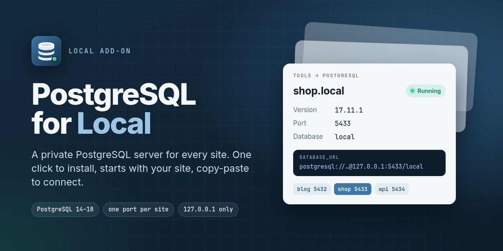

<p align="center">
  
</p>

# PostgreSQL for Local

A [Local](https://localwp.com) add-on that gives **each site its own PostgreSQL server**, installed and managed from Local's window. You don't need Docker, Homebrew or a system-wide install.

**[Read the full user guide →](docs/GUIDE.md)**

## Features

- **One-click install.** Downloads a portable PostgreSQL build (14 – 18) and checks it against the published SHA-256 checksum, which catches damaged downloads.
- **One server per site.** Each site gets its own data folder, port, password and a default `local` database.
- **Follows the site.** PostgreSQL starts and stops with the site (optional per site). Quitting Local stops every server.
- **Manage it in Local.** **Tools → PostgreSQL** has start/stop/restart, a port changer, connection details with copy buttons, a `DATABASE_URL` line, create/drop databases, the server log and installed versions.
- **Private by default.** Servers listen only on `127.0.0.1`, with Unix sockets off and SCRAM-SHA-256 passwords.
- **Works on older Linux.** On systems like Ubuntu 22.04, bundled libraries that need a newer glibc are swapped for the system's own copies.

> WordPress and Local's PHP don't use PostgreSQL. This add-on is for the apps and tools you run next to a site: Node, Python, Go or Laravel apps, headless front ends, scripts, and database GUIs.

## Quick start

1. Quit Local.
2. Get the add-on and install it:

   ```bash
   git clone https://github.com/shahadul878/local-addon-postgresql.git
   cd local-addon-postgresql
   npm run install-addon
   ```

   No `npm install` is needed: the add-on has no runtime dependencies. Prefer clicking? Run `npm pack` and use **Add-ons → Installed → Install from disk** in Local ([details](docs/GUIDE.md#3-installing-the-add-on)).

3. Start Local, open a site, go to **Tools → PostgreSQL** and click **Download & enable**.
4. Copy the `DATABASE_URL` line into your app:

   ```dotenv
   DATABASE_URL=postgresql://postgres:<password>@127.0.0.1:5432/local
   ```

## Requirements

- Local 6 or newer (built and checked against Local 10.2)
- Linux x64/arm64 with glibc 2.34+ (Ubuntu 22.04+, Debian 12+), macOS (Intel or Apple Silicon), or Windows 10+ (x64/arm64)
- About 120 MB of disk per PostgreSQL version

## Guide

| Topic | |
| --- | --- |
| Installing, two ways | [Section 3](docs/GUIDE.md#3-installing-the-add-on) |
| Connecting from apps, `psql` and GUI tools | [Section 5](docs/GUIDE.md#5-connecting-to-the-database) |
| Start/stop, auto-start and changing the port | [Section 6](docs/GUIDE.md#6-running-the-server) |
| Versions and running several sites | [Sections 8 – 9](docs/GUIDE.md#8-postgresql-versions) |
| Backups with `pg_dump` (Local's Backups tab skips PostgreSQL) | [Section 10](docs/GUIDE.md#10-backups-and-moving-data) |
| Troubleshooting | [Section 13](docs/GUIDE.md#13-troubleshooting) |

## Development

```bash
npm install                # test dependencies only (React 16.14, as shipped by Local)
npm test
npm run coverage
npm run link-addon         # symlink into Local; restart Local to load edits
npm run uninstall-addon
scripts/render-assets.sh   # re-render assets/*.png from assets/src (needs Chrome)
```

The add-on is plain CommonJS with no build step. The UI uses Local's own React instance.

```
lib/
  main.js             main-process entry: wires the service, IPC and site hooks
  renderer.js         renderer entry: adds the Tools → PostgreSQL tab
  postgresService.js  business logic used by IPC and lifecycle hooks
  binaryManager.js    download → verify → extract PostgreSQL builds
  glibcCompat.js      swaps bundled Linux libraries that need a newer glibc
  instanceManager.js  initdb / pg_ctl / psql / createdb / dropdb per site
  configStore.js      atomic, serialised JSON settings store
  ipc.js              channel → service routing
  ui/                 panel container, sections, components, styles, IPC client
```

PostgreSQL builds come from [theseus-rs/postgresql-binaries](https://github.com/theseus-rs/postgresql-binaries). Edit `SUPPORTED_VERSIONS` in `lib/constants.js` to offer other releases.

## License

[MIT](LICENSE). PostgreSQL itself is distributed under the [PostgreSQL License](https://www.postgresql.org/about/licence/).
